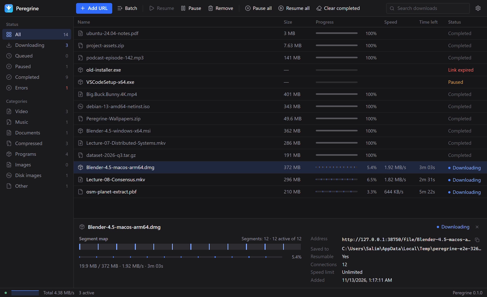

<p align="center">
  
</p>

<h1 align="center">Peregrine</h1>

<p align="center">
  <b>The fast, free, open-source download manager.</b><br>
  A free alternative to IDM and FDM.<br>
  Multi-connection downloads · crash-proof resume · browser integration · no ads, no tracking.
</p>

<p align="center">
  <a href="https://github.com/Salim8519/Peregrine/releases/latest"></a>
  <a href="https://github.com/Salim8519/Peregrine/actions/workflows/ci.yml"></a>
  <a href="LICENSE"></a>
</p>

<p align="center"></p>

---

Peregrine is named after the peregrine falcon, the fastest animal on Earth. It splits each
download into many parallel connections, keeps re-balancing them while it runs, and never
loses progress — not on a dropped connection, not on a crash, not on a power cut.

> **Status: early preview (v0.x).** Windows and macOS. Builds are not code-signed yet, so
> Windows SmartScreen and macOS Gatekeeper will warn on first launch (see [Install](#install)).

## Features

- **Fast** — up to 32 connections per file with *dynamic segmentation*: when a connection
  finishes, it takes over half of the slowest remaining part, so all connections stay busy
  until the end. Uses real parallel TCP connections ([why](docs/decisions/0006-http11-for-segments.md)).
- **Never loses a download** — progress is saved to a crash-safe database every second;
  data goes to `name.peregrine.part` and is renamed only after it is verified.
- **Smart resume** — detects when a file changed on the server, and lets you paste a fresh
  link when an old one expires, keeping what you already downloaded.
- **Browser integration** — extension for Chrome, Edge, Brave, Opera and Vivaldi catches
  downloads (with cookies, so logged-in downloads work) and detects videos on the page.
  Without the extension, the clipboard monitor catches copied links.
- **Queue & control** — max active downloads, global and per-download speed limits,
  categories, pause/resume everything, SHA-256 shown for every file, checksum verification.
- **Secure** — no telemetry, filenames sanitized against path tricks, Mark-of-the-Web /
  quarantine on downloaded files, local API locked to 127.0.0.1 with a secret token.
- **16 languages:** English, Arabic, Chinese (Simplified), French, German, Hindi, Indonesian, Italian, Japanese, Korean, Persian, Portuguese (Brazil), Russian, Spanish, Turkish and Urdu, with full right-to-left layout for Arabic, Persian and
  Urdu. Light and dark themes. The browser extension speaks the same 16 languages and follows
  your browser's language.
- **CLI** — `peregrine get <url>` for scripts and servers (Windows, macOS, Linux).

## Install

Download from the [latest release](https://github.com/Salim8519/Peregrine/releases/latest):

| Platform | File |
|---|---|
| Windows 10/11 (x64) | `Peregrine-<version>-windows-x64-setup.exe` (or the portable `.zip`) |
| macOS 12+ (Intel & Apple Silicon) | `Peregrine-<version>-macos-universal.dmg` |
| Browser extension | `Peregrine-<version>-chromium-extension.zip` (store listing coming) |
| CLI (Windows/macOS/Linux) | `peregrine-cli-<version>-<os>-<arch>` |

Verify downloads with `SHA256SUMS.txt` from the same release.

**First launch on unsigned builds**
- Windows: SmartScreen → *More info* → *Run anyway*.
- macOS: right-click `Peregrine.app` → *Open* → *Open* (or System Settings → Privacy & Security → *Open Anyway*).

**Browser extension (until it is in the stores)**: on first launch Peregrine shows a
*Connect your browser* guide — it opens your browser's extensions page and the bundled
extension folder; turn on *Developer mode*, click *Load unpacked*, pick the folder. The guide
turns green when the extension connects. (Reopen it from Settings → Browser & clipboard.)

## CLI

```bash
peregrine get https://example.com/big.iso -o ~/Downloads -c 16 --limit 5M
peregrine get https://example.com/big.iso -o ~/Downloads   # run again to resume
peregrine add https://example.com/file.zip                  # send to the desktop app
peregrine list
```

## Build from source

Requirements: Go 1.27.4+, Node 22+, [Wails v2](https://wails.io) (`go install github.com/wailsapp/wails/v2/cmd/wails@latest`).

```bash
go test -race ./...                 # engine, API, CLI end-to-end tests
go build ./cmd/peregrine            # CLI
cd desktop && wails build           # desktop app -> desktop/build/bin
```

See [docs/](docs/) for the [spec](docs/SPEC.md), [roadmap](docs/ROADMAP.md),
[API](docs/API.md) and [design decisions](docs/decisions/).

## Contributing

Bug reports and pull requests are welcome. Read [CONTRIBUTING.md](CONTRIBUTING.md) first, and
please follow the [Code of Conduct](CODE_OF_CONDUCT.md).

## How it is built

| Part | Tech |
|---|---|
| Engine | Go — `engine/` (segmented downloads, queue, SQLite state) |
| Desktop app | Wails + React + TypeScript — `desktop/` |
| Browser extension | Manifest V3 — `extension/`, talks to the app through a native messaging host (`cmd/peregrine-host`) |
| Tests | an "evil" test server (`internal/testsrv`) that drops connections, throttles, refuses ranges and expires links; Playwright end-to-end tests for the UI and extension |

This project is built with AI assistance ("vibe-coded") with strict rules — see
[CLAUDE.md](CLAUDE.md). Every decision is recorded in [docs/decisions](docs/decisions/).

## Security

Verify downloads with `SHA256SUMS.txt` and the signed build provenance
(`gh attestation verify <file> -R Salim8519/Peregrine`). How Peregrine is protected and how to
report a vulnerability: [SECURITY.md](SECURITY.md) · threat model: [docs/SECURITY-MODEL.md](docs/SECURITY-MODEL.md).

## Privacy

Peregrine makes no network requests except the downloads you start. No analytics, no
accounts, no ads. The browser extension only talks to the Peregrine app on your own computer
([extension privacy policy](extension/PRIVACY.md)).

## License

[GPL-3.0-or-later](LICENSE). Peregrine is free software and will stay free.
